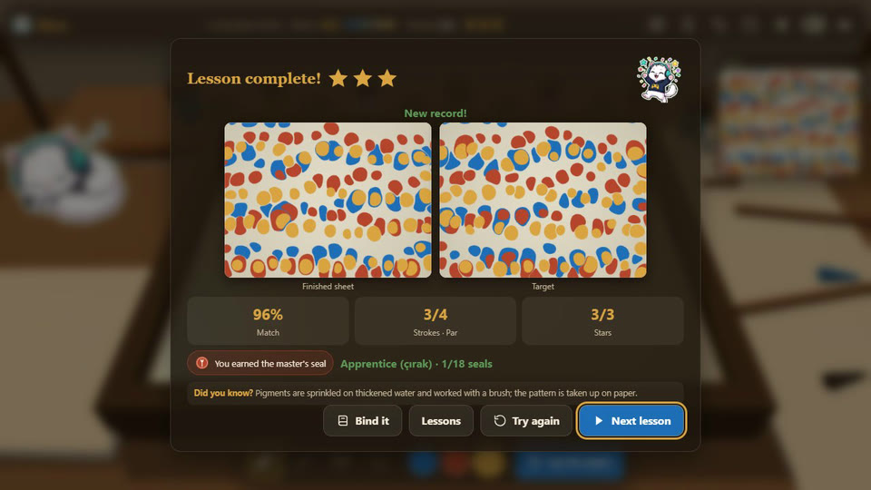
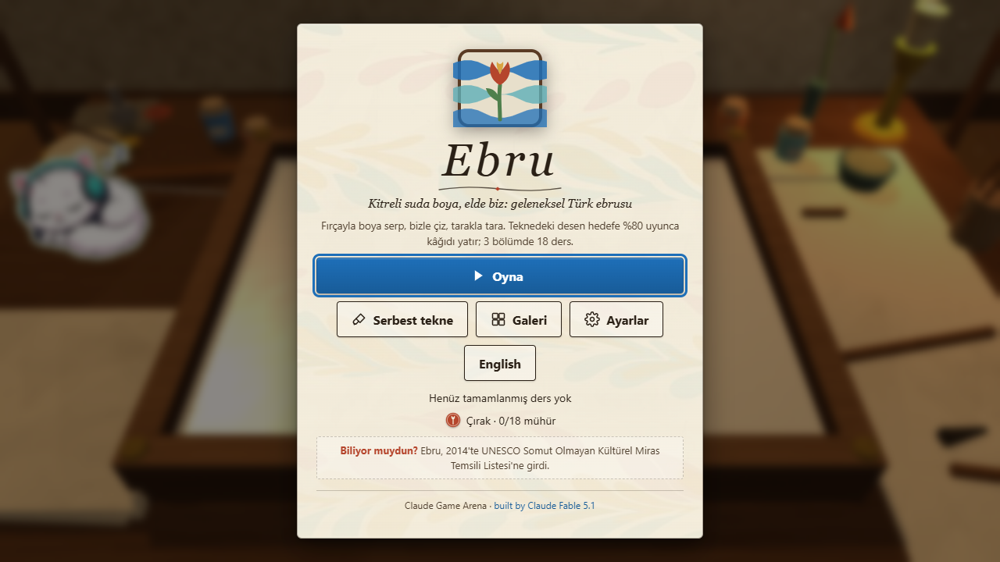
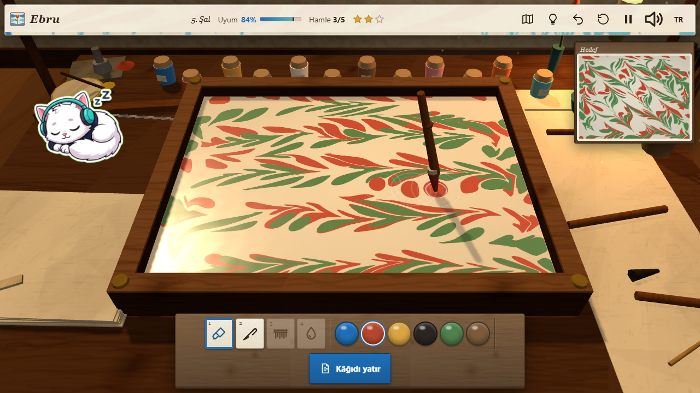
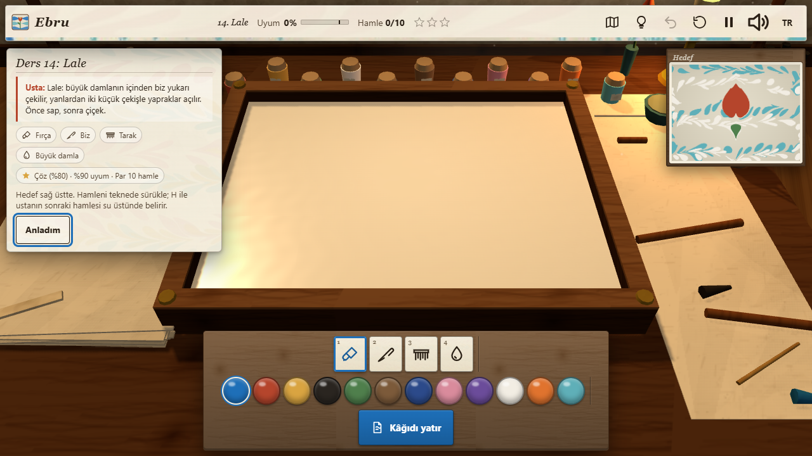
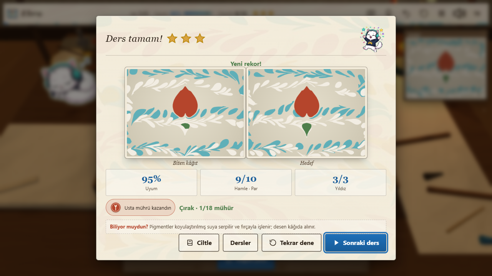
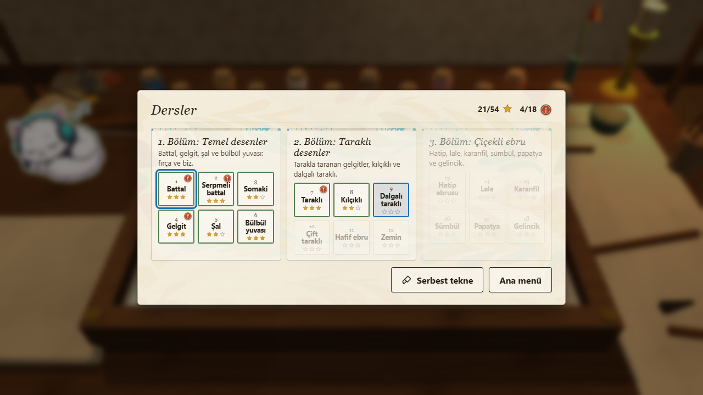
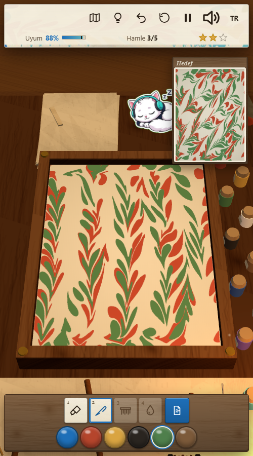
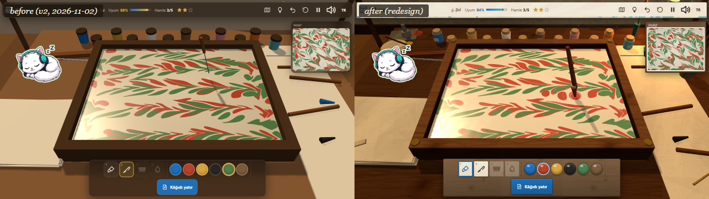

<p align="center">
  <a href="https://furkiozknn.github.io/ebru/">
    
  </a>
</p>

<p align="center">
  <a href="https://furkiozknn.github.io/ebru/"></a>
</p>

<p align="center">
  
  
  <a href="LICENSE"></a>
  
</p>

<!-- portals:start -->
<p align="center">
  Also on: <a href="https://furkiozknn.itch.io/ebru"><strong>itch.io</strong></a> &middot; <a href="https://playgama.ai/play/ke6m2clqm3wudz"><strong>Playgama</strong></a>
</p>
<!-- portals:end -->

<p align="center">
  <strong>A 3D art puzzle about traditional Turkish paper marbling (ebru): sprinkle earth pigments on thickened water, draw through them with the awl and the comb, shape tulips and carnations, and lay the paper when the tray matches the master's pattern.</strong>
</p>

<!-- gameplay gif -->

## Features

- **18 lessons in 3 chapters:** Master basic patterns (battal, gelgit, şal, bülbül yuvası), combed patterns (taraklı, kılçıklı, wavy and double combing, hafif) and flower ebru (hatip, tulip, carnation, hyacinth, daisy, poppy) with progressive pigment and tool unlocks and master technique notes.
- **Mathematical marbling simulation:** Every drop is a closed polygon and every tool deforms the surface in closed form across fixed 8-unit steps; new drops push older rings outward, the awl draws a chevron wake, and the comb pulls 25 tines at once without colours ever mixing into mud.
- **Master's critique & 18 seals:** Real-time feedback checks pigment volume and centroids against the target; reach 80% match to lay the paper, or achieve 90% within par strokes and with no hints to earn a red master's seal, rising from çırak through kalfa to usta across 54 stars.
- **Free tray, water thickness & gallery:** Paint freely on thin, medium, or thick water with 12-stroke undo, store up to 12 sheets in the 256 px gallery, and bind any sheet into a leather-cornered book cover while finished prints hang to dry on the line.
- **Ultra-lean web performance:** A single `index.html` with Three.js r170 delivering 60 fps at 14–18 draw calls on Intel UHD 620 (5.4–5.9k triangles, 14 calls on `?low`), verified by an automated bot across all 18 lessons with 48/54 stars, 12/18 seals, and 0 JS errors.

## How to play

> [!TIP]
> **Goal:** Recreate the master's pattern in the corner. Reach 80% match to lay the paper. Earn up to 3 stars per lesson: solve, reach 90% match, and stay within par strokes.

1. **Sprinkle pigments (`1`, `4`):** Select a tool and an earth pigment from the bottom walnut tray. Drag over the water to sprinkle drops with the brush (`1`), or open a wide ring for flowers with the big drop (`4`).
2. **Draw and comb (`2`, `3`):** Draw through the wet size with the awl / *biz* (`2`) to pull veins and petals, or drag the 25-tine comb / *tarak* (`3`) across the tray to produce wavy, chevron, or combed patterns.
3. **Lay the paper (`Enter`):** Watch the master's live critique as the match score rises; at 80% match the screen rim glows. Press **Lay the paper** (`Enter`) to drop the paper onto the size and take up your print.

<details>
<summary><b>Techniques, seals and free tray</b></summary>

- **Solvable target recipes:** The 18 lessons are recipe tables replayed deterministically at load; press `H` to preview the next recipe stroke as a ghost on the water (free first-stroke ghost in lessons 1–3).
- **Master's seals & ranks:** Reaching 90% match within par strokes and without hints earns a red wax master's seal; 18 seals advance your rank from apprentice (*çırak*) through journeyman (*kalfa*) to master (*usta*). Total of 54 stars.
- **Undo:** Keeps the last 12 strokes; clearing the tray (`R`) is undoable too.
- **Free tray & water thickness:** Paint whatever you like without targets. Press `T` to toggle water thickness: thin, medium, or thick (scales drop radius, spacing, and awl/comb wake; lessons, targets and bot always use the medium table).
- **Bookbinding & gallery:** In the free tray, `Enter` saves a 256 px JPEG of the sheet to the gallery (up to 12 sheets in `localStorage`). Press `B` (or the Bind button) to bind any saved sheet into a book cover with leather spine and corners.
- **UNESCO Ebru facts:** "Did you know?" facts on title and result cards come from the UNESCO Representative List entry for ebru (inscribed 2014): earth pigments on thickened water worked with horsehair brushes, taken up on paper, used in bookbinding, learned over years from master to apprentice.

</details>

### Controls

| Action | Mouse / touch | Keyboard |
|---|---|---|
| Stroke | Drag on the water | |
| Tool: brush, awl, comb, big drop | Tool tray | `1` `2` `3` `4` |
| Colour | Swatches | |
| Zoom | Wheel / pinch | |
| Undo / clear the tray | HUD buttons | `Z` / `R` |
| Lay the paper | Tray button | `Enter` |
| Hint (ghost of next stroke) | HUD button | `H` |
| Lesson map | HUD button, pause menu, result card | |
| Pause | HUD button | `P` / `Esc` |
| Music / effects / language / fullscreen | HUD buttons | `M` / `X` / `L` / `F` |
| Water thickness (free tray) | Thin / medium / thick switch | `T` |
| Bind last saved sheet (free tray) | Tray button | `B` |
| Gallery (free tray) | Tray button | `G` |

- **Global hotkeys:** `P` / `Esc` pause, `M` music, `X` effects, `L` language, `F` fullscreen, `Z` undo, `R` clear tray, `H` hint, `T` water thickness, `B` bind, `G` gallery.
- **Audio control:** Pure Web Audio synthesis for drips tuned by drop size, awl speed swishes, paper rustles, and a traditional Hicaz ney and kanun melody over drone; volume and mute controls in HUD and pause menu.
- **Touch:** Full touch support with drag to paint/comb, pinch to zoom, and responsive mobile tool tray and swatch row.
- **Persistence:** Settings (master / music / effects volume, mute, TR / EN, Low / High quality, fullscreen) are saved in `localStorage` under `arena.ebru.settings`; stars, seals and current lesson under `arena.ebru.save`; best star total under `arena.ebru.best`; gallery under `arena.ebru.gallery`; and bound cover flags under `arena.ebru.bound` (v1 saves load unchanged). Turkish is the default language (English when the browser is not Turkish); phones start on the Low tier.

<details>
<summary><b>URL flags for testing</b></summary>

| Flag | Effect |
|---|---|
| `?auto` | A bot plays all 18 lessons to the ending through the same stroke API as the player, with a small hand tremor (`&jitter=N` units, default 6) |
| `?debug` | FPS, JS ms per frame, draw calls, triangles, polygon and point counts, GPU name and JS errors on screen; `window.ebruSim(seconds)` and `window.ebruDebug` |
| `?sim=N` | Fast-forward N seconds before the first frame |
| `?low` | Shadows off, pixel ratio 1, 512 px paint target, half the dust |
| `?lesson=N` | Open lesson N (1–18) directly; `?free` opens the free tray |
| `?lang=en` / `?lang=tr` | Language |
| `?nosave` | Do not write to `localStorage` |
| `?noassets` | Skips the three mascot PNGs (the only asset files); everything else is generated in code |

`window.ebru` exposes the live state (`state`, `lesson`, `match`, `strokes`, `stars`, `seals`, `rank`, `thickness`, `critique`, `polys`, `points`, `fps`, `calls`, `bot log`, `errors`, `assets`).

</details>

## Screenshots

<table>
  <tr>
    <td width="33%"><br><sub>Title screen</sub></td>
    <td width="33%"><br><sub>Drops rippling on the wet size</sub></td>
    <td width="33%"><br><sub>A lesson and the master's note</sub></td>
  </tr>
  <tr>
    <td><br><sub>The finished sheet, three stars and the seal</sub></td>
    <td><br><sub>Three chapters, 18 lessons, seals</sub></td>
    <td><br><sub>On a phone</sub></td>
  </tr>
</table>

## Redesign & Performance

**Art direction:** Ink & paper fine art. The master's workshop in morning window light (walnut `#5A3A20`, cream paper `#F3EAD8`, lime plaster `#E8E2D5`, ebru blue `#1E6FB8`, red-ochre wax `#B5452C`, brass `#D9A441`, zinc `#8A9A86`).

**Visual updates (rules, controls, bot, and saves are untouched):**
- **Room:** Canvas-generated wood grain, lime plaster, and laid-paper textures on three merged static meshes with world-projected UVs; a woven kilim; morning window with sky, cypress, and distant dome casting a soft shaft of sunlight; flickering oil lamp point light with flame sprite; equirectangular PMREM reflections so the water and steel catch the window.
- **Wet size:** Low-roughness water surface with a slowly creeping ripple normal map under the paint; pigment reads wet rather than printed.
- **Master's table & tools:** Oil lamp, size bowl with ladle, ox-gall bowl, muller with ground ochre, cup of rose-twig brushes, reed pen, tulip in a vase, spare combs, calligraphy wall panel, drying marbled sheets swaying on the line, scrap paper basket, brass nails on walnut tray rim, and sleeping Turkish Van kitten on the table edge; rose-twig horsehair brush, turned-handle awl with brass ferrule, walnut comb with brass strip.
- **Animation:** Expanding rings where drops fall, dipping brush, paper bowing as it falls and bellies as it peels off the water, swaying line sheets, flickering lamp flame.
- **UI:** Hafif ebru paper sheets drawn by the game's own simulation under a cream wash, dark ink text, calligraphic italic serif headers, ebru-blue ink buttons, animated red wax seal stamp, and paper HUD strip. Dedicated full-width mobile layout with swatches on their own row.

**Measured on an Intel UHD 620 at 1280x720 (headless Chrome):**
- Framerate: locked 60 fps before and after
- Draw calls: 9–10 &rarr; 14–18 (14 on `?low`; 7–10 in v2)
- Triangles: 2.8k &rarr; 5.4–5.9k
- Bot verification: `?auto` bot completes all 18/18 lessons with 48/54 stars, 12/18 seals with assets and with `?noassets` at 0 JS errors



## Running locally

Serve the folder over HTTP (ES modules do not load from `file://`):

```bash
python -m http.server 8000
```

Then open <http://localhost:8000/>.

## Made with Claude Code

Built by **Claude Fable 5.1** with Claude Code from one prompt: [prompts/ebru.md](prompts/ebru.md). Everything is generated in code; Three.js is loaded from jsDelivr under its MIT licence.

### v2 update

Upgraded by **Claude Fable 5.1** with Claude Code from [prompts/ebru-v2.md](prompts/ebru-v2.md):

- **One-click play:** Play drops straight into the first unsolved lesson; the master's note is a card over the tray that fades at the first stroke; lessons 1–3 show the first recipe stroke as a ghost and pulse "Lay the paper" at 80%.
- **Master's critique:** Real-time feedback identifies the worst two pigment deviations (unused, too little, too much, wrong place, not in target) under the tray and on the result card, with an 80% rim glow and chimes at 80% / 90%.
- **Master's seal:** Reaching 90% match, within par, and without hints awards a red wax seal; 18 seals rank you from çırak through kalfa to usta. 54 stars total.
- **Water thickness:** Free tray offers thin, medium, and thick water thickness (scales drop radius, spacing, and awl/comb falloff); lessons and bot retain the medium table.
- **Bookbinding & gallery:** Save up to 12 sheets in the gallery and bind any sheet into a 2D leather-cornered book cover; flags stored in `arena.ebru.bound`.
- **UNESCO facts & kitten:** Sourced facts from the UNESCO Representative List on title and result cards; Turkish Van kitten sleeping on the table edge and reacting on result cards.

### Redesign (2026-11)

Redesigned by **Claude Fable 5.1** with Claude Code (branch `redesign`). Art direction: **ink & paper fine art**, the master's workshop in morning window light. Rules, lessons, targets, scoring, seals, saves, flags, and bot are completely preserved.

<details>
<summary><b>Technical notes</b></summary>

- **Simulation (`SIMLIB`, pure JavaScript, no DOM):** A drop at $C$ with radius $r$ moves points $P$ to $C + (P - C) \sqrt{1 + r^2 / |P - C|^2}$; the awl and comb move points along motion by $\exp(-d/\lambda)$ across the path, applied in fixed 8-unit steps so results are independent of pointer event rate. Polygons are dynamically resampled and clamped to tray walls.
- **Match scoring:** CPU-rasterised colour comparison on a 16x12 grid plus per-pigment volume and centroid tracking against recorded stroke lists.
- **Paint rendering:** Single dynamic `BufferGeometry` of triangle fans with three material groups per colour (signed-winding stencil pass: +1 front, -1 back, colour quad where non-zero) rendered into a 4x MSAA render target that textures the water at 60 fps with 100,000+ points on Intel UHD 620.
- **3D workshop scene:** Vertex-coloured, flat-shaded workshop merged into static meshes with world-projected UVs, instanced pigment jars, directional light with shadow map, soft-sprite dust motes, and normal-mapped ripple water surface. 14–18 draw calls per frame.
- **Web Audio:** Drips tuned by drop size, band-passed awl speed swishes, paper rustle, and slow Hicaz ney melody over drone with kanun response.

</details>

### Claude Game Arena

Ebru is part of the **Claude Game Arena** series, where each game is built by a Claude model from one prompt.

[Hisar](https://furkiozknn.github.io/kale-savunmasi/) · [Çay Ocağı](https://furkiozknn.github.io/cay-ocagi/) · [Çini Ustası](https://furkiozknn.github.io/cini-ustasi/) · [Martı](https://furkiozknn.github.io/marti/) · [Kervan](https://furkiozknn.github.io/kervan/) · [Dolmuş](https://furkiozknn.github.io/dolmus/) · [Peri Golf](https://furkiozknn.github.io/peri-golf/) · [Mehter](https://furkiozknn.github.io/mehter/) · [Boğaz Vapuru](https://furkiozknn.github.io/bogaz-vapuru/) · [Simit Fırını](https://furkiozknn.github.io/simit-firini/) · [Karagöz](https://furkiozknn.github.io/karagoz/) · [Lale Bahçesi](https://furkiozknn.github.io/lale-bahcesi/)

**Round 5:** [Kapadokya Balonu](https://furkiozknn.github.io/kapadokya-balonu/) · [Kırkpınar](https://furkiozknn.github.io/kirkpinar/) · [Çarşı Kaçışı](https://furkiozknn.github.io/carsi-kacisi/)

**Round 6:** [Topkapı Gecesi](https://furkiozknn.github.io/topkapi-gecesi/) · [Hamsi](https://furkiozknn.github.io/hamsi/) · [Pamukkale](https://furkiozknn.github.io/pamukkale/) · [Mimar Sinan](https://furkiozknn.github.io/mimar-sinan/)

## License

MIT, see [LICENSE](LICENSE).

Like the game? You can support new rounds on [Buy Me a Coffee](https://buymeacoffee.com/furkiozkann). The game stays free.
