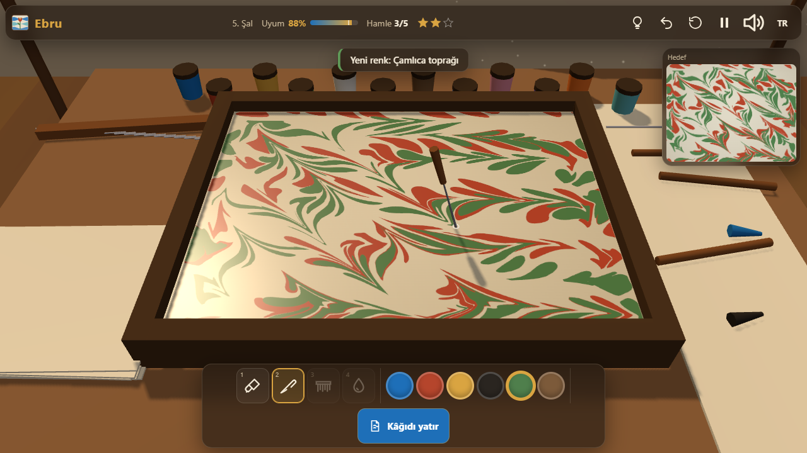
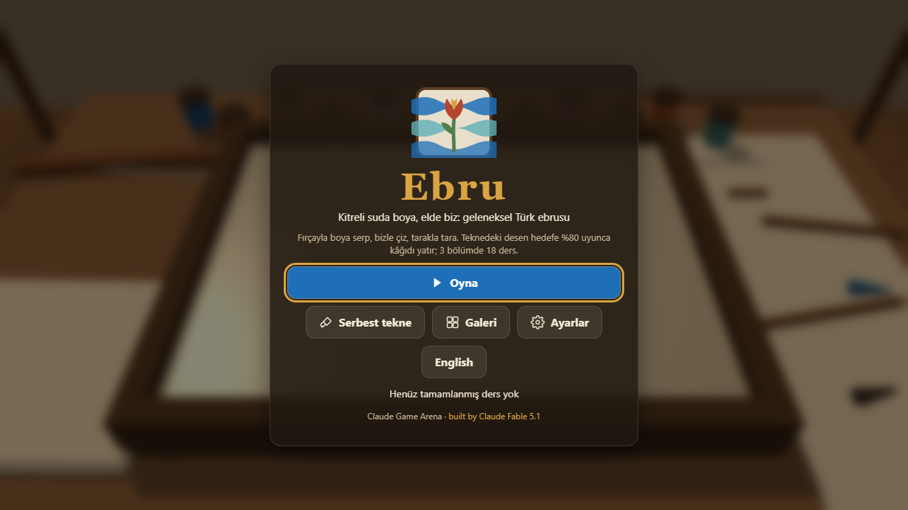
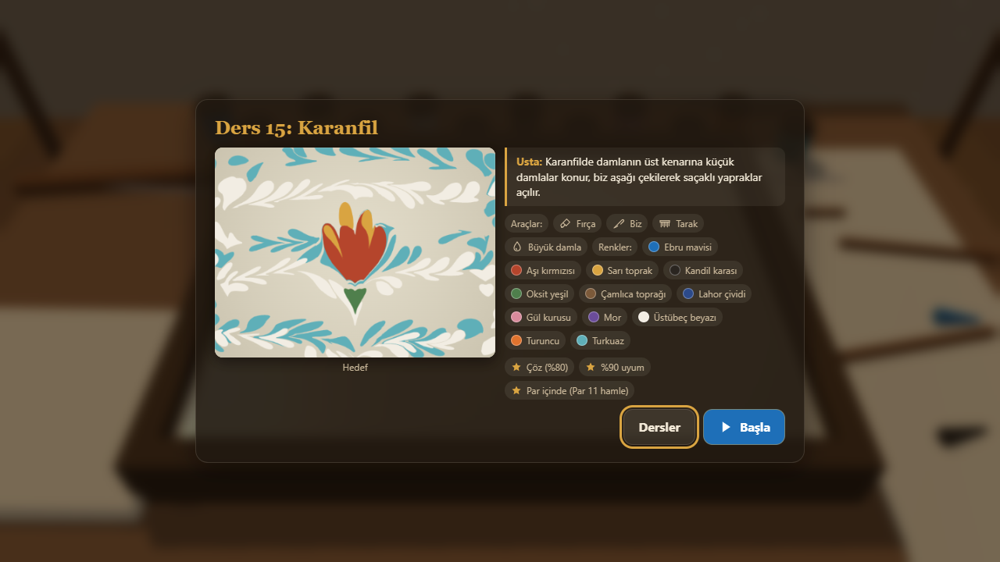
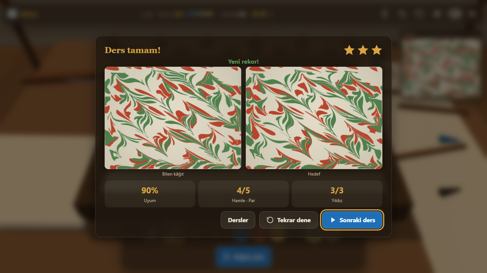
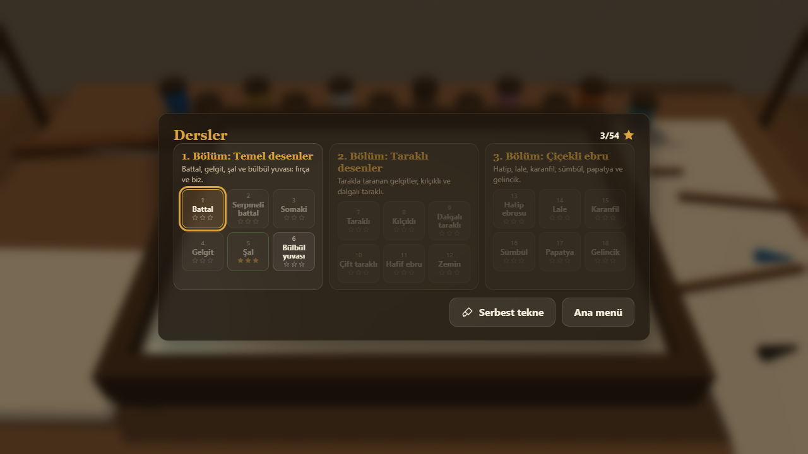
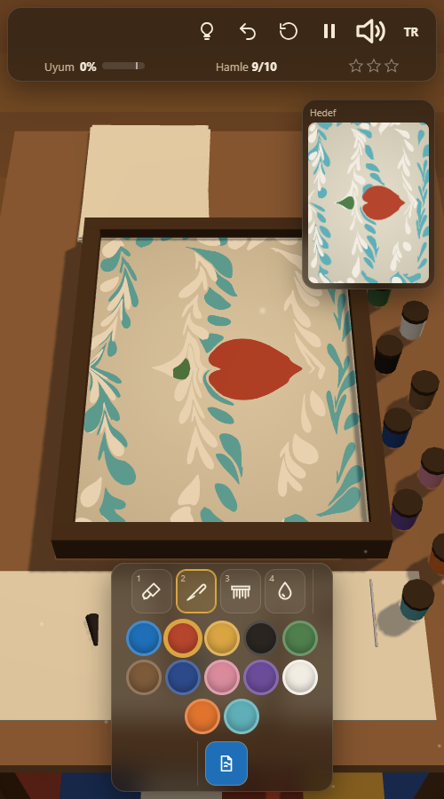

<p align="center">
  <a href="https://furkiozknn.github.io/ebru/"></a>
</p>

<p align="center">
  <a href="https://furkiozknn.github.io/ebru/"></a>
  
  
  <a href="LICENSE"></a>
  
</p>

<p align="center"><b>A 3D art puzzle about traditional Turkish paper marbling (ebru): sprinkle earth pigments on thickened water, draw through them with the awl and the comb, shape tulips and carnations, and lay the paper when the tray matches the master's pattern.</b></p>

<p align="center"><b>Play online: <a href="https://furkiozknn.github.io/ebru/">https://furkiozknn.github.io/ebru/</a></b> (desktop and phone, no install)</p>

## Highlights

- **Marbling that behaves like marbling.** Every drop is a closed polygon and every tool is a closed-form deformation of
  the whole surface (the "mathematical marbling" model): a new drop pushes older paint outward in rings, the awl drags a
  chevron wake behind it, the comb pulls twenty-five tines at once. Colours never mix into mud because each band stays
  its own polygon. The same deterministic simulation runs for the player, the targets and the bot.
- **18 lessons in 3 chapters.** Basic patterns (battal, gelgit, şal, bülbül yuvası), combed patterns (taraklı, kılçıklı,
  wavy and double combing, hafif) and flower ebru (hatip, tulip, carnation, hyacinth, daisy, poppy). Each lesson unlocks
  tools and pigments and opens with a short TR / EN note from the master with real names and facts.
- **Provably solvable targets.** Every target is a recorded stroke list replayed in the same simulation; the live match %
  compares the tray with the target, and the hint replays the next stroke as a ghost on the water.
- **Free tray and gallery.** Paint whatever you like, lay the paper and keep up to 12 sheets in the gallery; your last
  sheets hang to dry on the line behind the table.
- **Paint rasterised on the GPU.** The polygons are filled with a signed-winding stencil pass into a multisampled render
  target, so a tray with a hundred thousand points still runs at 60 fps on an Intel UHD 620.
- **One file, made in code.** One `index.html` with Three.js r170 from a CDN; every mesh, texture, icon and sound
  (drips, swishes, paper rustle, a ney and kanun loop) is generated in code.

## How to play

> [!TIP]
> **Goal:** make the tray look like the target in the corner. Reach 80 % match and lay the paper. Three stars per lesson:
> solve, reach 90 %, and stay within par strokes.

Pick a tool and a pigment from the tray at the bottom. Drag over the water: the brush sprinkles drops as you move, the awl
(biz) and the comb (tarak) drag the paint with them, the big drop opens a wide circle for flowers. Press `H` to see the
next stroke of the master's recipe as a ghost. When the match reaches 80 %, lay the paper with `Enter`.

<details>
<summary><b>More</b></summary>

- The lessons are a data table of recipes in the code; targets are generated by replaying them when the game loads.
- Undo keeps the last 12 strokes; clearing the tray is undoable too.
- In the free tray, `Enter` lays the paper and saves a 256 px JPEG of the sheet to the gallery (localStorage).
- Facts in the master's notes: ebru was inscribed on UNESCO's Intangible Cultural Heritage list in 2014; Hatip Mehmed
  Efendi (d. 1773) shaped concentric drops with the awl; Necmeddin Okyay (1883-1976) developed flower ebru; his student
  Mustafa Düzgünman (1920-1990) added the daisy.

</details>

### Controls

| Action | Mouse / touch | Keyboard |
|---|---|---|
| Stroke | drag on the water | |
| Tool: brush, awl, comb, big drop | tool tray | `1` `2` `3` `4` |
| Colour | swatches | |
| Zoom | wheel, pinch | |
| Undo / clear the tray | HUD buttons | `Z` / `R` |
| Lay the paper | tray button | `Enter` |
| Hint (ghost of the next stroke) | HUD button | `H` |
| Pause | HUD button | `P` / `Esc` |
| Music / effects / language / fullscreen | HUD buttons | `M` / `X` / `L` / `F` |
| Gallery (free tray) | tray button | `G` |

Settings are saved in `localStorage` under `arena.ebru.settings`; stars and the current lesson under `arena.ebru.save`,
the best star total under `arena.ebru.best`, the gallery under `arena.ebru.gallery`. Turkish is the default language
(English when the browser is not Turkish); phones start on the Low tier.

<details>
<summary><b>URL flags for testing</b></summary>

| Flag | Effect |
|---|---|
| `?auto` | a bot plays all 18 lessons to the ending, making the recipe strokes through the same stroke API as the player, with a small hand tremor (`&jitter=N` units, default 6) |
| `?debug` | fps, JS ms per frame, draw calls, triangles, polygon and point counts, GPU name and JS errors on screen; `window.ebruSim(seconds)` and `window.ebruDebug` |
| `?sim=N` | fast-forward N seconds before the first frame |
| `?low` | shadows off, pixel ratio 1, 512 px paint target, half the dust |
| `?lesson=N` | open lesson N (1-18) directly; `?free` opens the free tray |
| `?lang=en` / `?lang=tr` | language |
| `?nosave` | do not write to `localStorage` |
| `?noassets` | accepted; the game ships no asset files, so it changes nothing |

The live state is on `window.ebru` (state, lesson, match, strokes, stars, polys, points, fps, calls, bot log, errors,
assets).

</details>

## Screenshots

<table>
  <tr>
    <td width="33%"><br><sub>Title screen</sub></td>
    <td width="33%"><br><sub>Şal: the awl drags the paint</sub></td>
    <td width="33%"><br><sub>A lesson and the master's note</sub></td>
  </tr>
  <tr>
    <td><br><sub>The finished sheet next to the target</sub></td>
    <td><br><sub>Three chapters, 18 lessons</sub></td>
    <td><br><sub>On a phone</sub></td>
  </tr>
</table>

## Running locally

Serve the folder over HTTP (ES modules do not load from `file://`):

```
python -m http.server 8000
```

then open <http://localhost:8000/>.

## How it was made

Built by **Claude Fable 5.1** with Claude Code from one prompt: [prompts/ebru.md](prompts/ebru.md). Everything is
generated in code:

- **Simulation:** a drop at C with radius r moves every point P to `C + (P - C) * sqrt(1 + r² / |P - C|²)`; the awl and the
  comb move points along their motion by `exp(-d/λ)` across the path and a window along it, applied in fixed 8-unit steps
  so the result does not depend on the pointer event rate. Polygons are resampled after every step and clamped to the
  tray walls; a point budget coarsens the sampling when the tray gets busy.
- **Match:** the tray and the target are rasterised small on the CPU; the score is a lenient colour comparison on a
  16x12 grid plus, for every pigment the target uses, how much of it the player used and where its centroid is.
- **Paint rendering:** one dynamic BufferGeometry of triangle fans with three material groups per colour (stencil +1 on
  front faces, -1 on back faces, colour quad where the stencil is non-zero), rendered in one call into a 4x MSAA
  render target that textures the water.
- **3D:** a flat-shaded, vertex-coloured workshop merged into one draw call, instanced pigment jars, one shadow-casting
  directional light over the table, soft-sprite dust in the window light, the active tool following the pointer and
  a paper sheet that drops, takes the pattern and lifts. About 6-10 draw calls per frame.
- **Audio:** Web Audio only: drips tuned by drop size, a band-passed swish that follows the awl's speed, paper rustles,
  and a slow ney phrase in a Hicaz-like scale over a drone with a kanun answering.

Ebru is part of the **Claude Game Arena** series, where each game is built by a Claude model from one prompt. The
other games: [Hisar](https://furkiozknn.github.io/kale-savunmasi/) ·
[Çay Ocağı](https://furkiozknn.github.io/cay-ocagi/) · [Çini Ustası](https://furkiozknn.github.io/cini-ustasi/) ·
[Martı](https://furkiozknn.github.io/marti/) · [Kervan](https://furkiozknn.github.io/kervan/) ·
[Dolmuş](https://furkiozknn.github.io/dolmus/) · [Peri Golf](https://furkiozknn.github.io/peri-golf/) ·
[Mehter](https://furkiozknn.github.io/mehter/) · [Boğaz Vapuru](https://furkiozknn.github.io/bogaz-vapuru/) ·
[Simit Fırını](https://furkiozknn.github.io/simit-firini/) · [Lale Bahçesi](https://furkiozknn.github.io/lale-bahcesi/) ·
[Karagöz](https://furkiozknn.github.io/karagoz/)

## Türkçe

**Ebru**, eski bir ebru atölyesinde geçen 3D sanat bulmacası. Kitreli suya fırçayla toprak boya serp, bizle çiz, tarakla
tara, lale ve karanfil aç; teknedeki desen ustanın hedefine %80 uyunca kâğıdı yatır. 3 bölümde 18 ders, her derste ustadan
kısa bir not; serbest tekne ve 12 kâğıtlık galeri. Kurulum yok; masaüstünde ve telefonda tarayıcıda oynanır. Claude
Fable 5.1 tarafından Claude Code ile tek bir prompt'tan yapıldı.

**Oyna:** https://furkiozknn.github.io/ebru/

## License

MIT, see [LICENSE](LICENSE).
